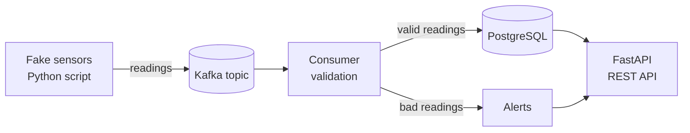

# Sensor Pipeline

A small data pipeline in Python that collects sensor readings (for example pipeline pressure
and temperature), checks them and serves them through a REST API.

I am building it to learn Python for data engineering, step by step.

## Planned flow



## Tech

Python 3.12 · FastAPI · Kafka · PostgreSQL · pytest · Ruff · Docker Compose · GitHub Actions

## Run it

Everything with Docker:

```bash
docker compose up --build
curl http://localhost:8000/health   # {"status":"ok"}
```

API docs (Swagger UI): http://localhost:8000/docs

Tests and linter locally:

```bash
python3 -m venv .venv
source .venv/bin/activate
pip install -r requirements-dev.txt
ruff check .
docker compose up -d postgres   # the database tests need it
pytest
```

## Roadmap

- [x] Project skeleton: FastAPI, Docker Compose, pytest, CI
- [ ] Fake sensor producer that sends readings to Kafka
- [ ] Consumer that validates readings (missing values, out-of-range numbers, duplicates)
- [ ] Save readings in PostgreSQL
- [ ] API endpoints: `GET /sensors/{id}/readings`, `GET /alerts`
- [ ] AI agent workflow: builder and reviewer agents working from GitHub Issues
