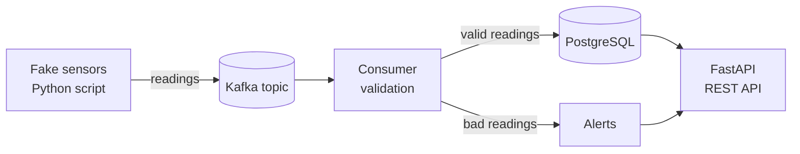

# Sensor Pipeline

A small data pipeline in Python that collects sensor readings (for example pipeline pressure
and temperature), checks them and serves them through a REST API.

I am building it to learn Python for data engineering, step by step.

## Planned flow



## Tech

Python 3.12 · FastAPI · Kafka · PostgreSQL · pytest · Ruff · Docker Compose · GitHub Actions

## Run it

Everything with Docker:

```bash
docker compose up --build
curl http://localhost:8000/health   # {"status":"ok"}
```

Dashboard: open http://localhost:8000 to see a chart of each sensor's readings and a table of
alerts. It refreshes every 5 seconds. It loads Chart.js from a CDN, so it needs internet access.

API docs (Swagger UI): http://localhost:8000/docs

The API has no authentication and is for local use only.

Send fake readings to Kafka (in the virtualenv from below):

```bash
docker compose up -d kafka
python -m app.producer --count 10 --interval 0.5   # leave out --count to run until Ctrl+C
```

Read the readings, check them and save them to PostgreSQL (needs Kafka and PostgreSQL):

```bash
docker compose up -d kafka postgres
python -m app.db         # creates the tables, only needed once
python -m app.consumer   # Ctrl+C to stop; prints how many readings and alerts it saw
```

Tests and linter locally:

```bash
python3 -m venv .venv
source .venv/bin/activate
pip install -r requirements-dev.txt
ruff check .
docker compose up -d postgres   # the database tests need it
pytest
```

## Removing old duplicates

The `readings` table has a unique index on `(sensor_id, metric, timestamp)`. If a
database already holds duplicates from before the index existed, creating the index
fails. Delete the extra rows first (this keeps the oldest row of each group):

```sql
DELETE FROM readings a
USING readings b
WHERE a.sensor_id = b.sensor_id
  AND a.metric = b.metric
  AND a.timestamp = b.timestamp
  AND a.id > b.id;
```

## How the agents work

- Label an issue `agent:builder` and the builder agent implements it and opens a PR.
- The reviewer agent runs on every PR and leaves review comments.
- Label a PR `agent:fixer` and the fixer agent applies the review comments.

The workflows live in `.github/workflows/`.

## Roadmap

- [x] Project skeleton: FastAPI, Docker Compose, pytest, CI
- [x] Fake sensor producer that sends readings to Kafka
- [x] Consumer that validates readings (missing values, out-of-range numbers, duplicates)
- [x] Save readings in PostgreSQL
- [x] API endpoints: `GET /sensors/{id}/readings`, `GET /alerts`
- [x] AI agent workflow: builder and reviewer agents working from GitHub Issues
